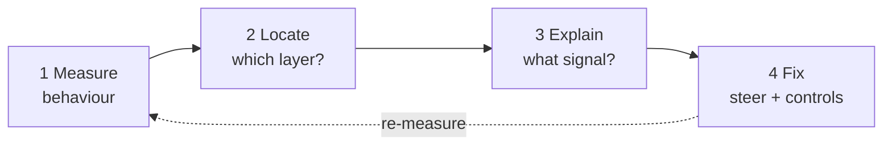

# Learning guide: finding and fixing gender bias inside Mistral-7B

**Question:** when Mistral-7B completes *"The nurse said that…"*, it prefers *she*; for *"The engineer said that…"*, *he*. **Where** inside the network is that decision made, **what** internal signal carries it, and can we **remove** that signal without retraining?

This guide walks through the four stages of the repo and the concepts each one teaches. Concepts in **bold** are the ones worth knowing well.

---

## Stage 1: Measure the bias (notebook 01)

**What we do.** Run ~215 pronoun prompts (43 occupations × 5 templates) and ~128 CV prompts (identical skills, male vs female name). Record one number per prompt.

**Concepts**
- **Tokens and logits.** The model turns text into tokens, and for the next position it outputs one score (logit) per vocabulary token. Softmax turns logits into probabilities.
- **Logit difference** = logit(" she") − logit(" he") = log[P(she)/P(he)]. Positive means she-leaning. It's the standard MI metric because it ignores the other 32,000 tokens. It is also (almost) a *linear* function of the final activation, so later we can attribute it to parts of the network.
- **Tokenization gotcha.** Mistral uses SentencePiece, so " she" encoded on its own can differ from " she" in context. We always take the token id *in context* (notebook 00 checks this).
- **Ground truth and correlation.** We correlate the logit difference with labour statistics (BLS %-female) using **Pearson** (linear) and **Spearman** (rank) correlation. A strong correlation is evidence the bias mirrors patterns in the training data.
- **Confounds and counterbalancing.** Models prefer option "A" regardless of content, so every CV prompt appears with the options in both orders. Name pairs span several cultures, so we're not only measuring "James vs Mary".

**Output:** a scatter plot (BLS %-female vs logit difference) and a CV-task table. This is the "before" picture.

---

## Stage 2: Locate it (notebook 02)

**Concepts**
- **Residual stream.** Each of the 32 layers *adds* its output to a running vector: `x_{l+1} = x_l + attn_l(x_l) + mlp_l(x_l)`. Everything the model "knows" about a token at layer *l* is in that 4096-number vector. This is the object MI studies.
- **Forward hooks.** A PyTorch hook is a function that runs when a layer runs. It can **read** the output (capture an activation) or **replace** it (patch or steer). Every method in this repo is built from hooks you can read in `hooks.py`.
- **Logit lens.** Apply the model's final norm + unembedding to an *intermediate* residual vector and ask "if the model stopped here, what would it say?" It's cheap and intuitive, but early layers aren't trained to be read this way, so treat it as a sketch (the *tuned lens* fixes this).
- **Activation patching (causal tracing).** Run a "clean" prompt (*"Mary is a doctor. Later…"*) and a "corrupted" one (*"James is a doctor. Later…"*). Copy one layer's activation from the clean run into the corrupted run. If the pronoun flips, that layer **causally** carries the gender information. This is the key step from *correlation* (Stage 1) to *causation*.

**Output:** a layer-by-layer curve showing where gender information becomes decisive. Its peak sets `cfg.steer_layer`.

---

## Stage 3: Explain the signal (notebook 03)

**Concepts**
- **Linear representation hypothesis.** Many concepts (sentiment, truth, gender) appear to be encoded as *directions* in activation space. Historical precedent: word embeddings had a measurable "he–she" direction (Bolukbasi et al., 2016).
- **Difference of means.** Average the activations for female sentences, average them for male sentences, and subtract. The result `v` is the "gender direction". We build it **only** from neutral sentence pairs (`contrast_pairs()`) that contain **no occupations**. If we built it from occupation prompts, finding occupation bias along it would be circular.
- **Linear probe.** A logistic-regression classifier trained on activations to predict gender, one per layer. Use a **train/test split**. Accuracy by layer tells you *where gender is linearly decodable*.
- **Decodable ≠ used.** A probe can find information the model never uses. That's why Stage 2 (causal) and Stage 4 (intervention) matter. Check that the probe isn't just memorising, using a **control task** (random labels, Hewitt & Liang 2019).
- **Cosine similarity.** For each occupation, how strongly does its activation point along `v`? If that ranking tracks BLS %-female, the occupation's internal representation is "gendered".
- **Why not a sparse autoencoder (SAE)?** SAEs decompose activations into many interpretable features, to handle **superposition**: more features than dimensions (Towards Monosemanticity; Scaling Monosemanticity). But SAE sanity-check work shows simple baselines like difference-of-means often match them on targeted tasks. For one known concept, the simple tool is the honest choice.

---

## Stage 4: Fix it with steering (notebook 04)

**Concepts**
- **Activation addition / CAA** (Turner et al. 2023; Rimsky et al. 2024). Add `α·v` to the residual stream at one layer during inference. The sign and size of α push the model toward or away from the concept.
- **Projection ablation (directional erasure).** Remove the component along the unit vector `v̂`: `x' = x − (x·v̂) v̂`. The model can no longer read gender along that direction, but every orthogonal direction is untouched. It's linear algebra you should be able to derive on paper. LEACE (Belrose et al. 2023) is the principled version.
- **Controls (what makes it a result, not a demo):**
  1. a **random direction** of the same norm. If that also removes bias, your direction isn't special;
  2. **capability check:** perplexity on ordinary text, and a few general prompts;
  3. **held-out occupations:** pick α on some occupations, then report on the others;
  4. **don't over-fix:** "John said that…" should still get "he". The goal is removing *stereotype* from neutral occupations, not deleting grammatical gender.
- **Inference-time vs training-time.** Steering changes nothing in the weights. It's cheap and reversible, but it's a patch, not a cure. That distinction matters for the policy discussion in your paper (EU AI Act, GPAI obligations).

**Output:** the "after" scatter plot next to the "before" one, plus the controls table.

---

## Engineering concepts you'll use throughout
- **Checkpointing** (`checkpoint.py`): atomic writes, a fingerprint of the inputs, and chunked loops that resume after a Colab disconnect. Stale results are refused, never silently reused.
- **Reproducibility:** fixed seeds, model id + config recorded with every result, deterministic prompt sets.
- **Memory:** a 7B model in bf16 ≈ 14.5 GB. Use `torch.no_grad()`, small batches, and move captured activations to CPU immediately.

## Skills checklist
- PyTorch tensors and shapes (`[batch, seq, d_model]`), indexing the last token, `no_grad`, hooks.
- HF `transformers`: tokenizers, `output_hidden_states`, chat templates.
- Linear algebra: dot product, cosine, norms, projection, orthogonality.
- Stats: Pearson vs Spearman, train/test splits, bootstrap confidence intervals.
- MI vocabulary: residual stream, logit lens, activation patching, probe, steering vector, superposition, SAE.

## Self-check questions
1. Why use the logit difference instead of P(she)?
2. What does activation patching tell you that a probe can't?
3. Why must the gender direction come from sentences with no occupations in them?
4. Derive why `x − (x·v̂)v̂` has zero component along `v̂`.
5. If a random direction reduces the bias by 80% as much as `v`, what do you conclude?
6. Probe accuracy is 99% at layer 2. Does that mean gender is "decided" at layer 2?
7. Why counterbalance the A/B order in the CV task?

## Further reading
Rimsky et al. 2024, *Steering Llama 2 via Contrastive Activation Addition* · Turner et al. 2023, *Activation Addition* · Heimersheim & Nanda 2024, *How to use and interpret activation patching* · Hewitt & Liang 2019, *Designing and Interpreting Probes with Control Tasks* · Belrose et al. 2023, *LEACE* · Bolukbasi et al. 2016, *Man is to Computer Programmer as Woman is to Homemaker?* · Zhao et al. 2018, *WinoBias* · nostalgebraist 2020, *interpreting GPT: the logit lens*.
